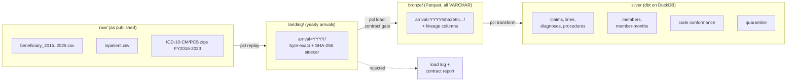

# Payer Claims Lakehouse

A member-level claims lakehouse in the shape a health plan runs: eligibility arrives month by month,
claims arrive by processing date, and both pass data contracts before they reach trusted tables. It is
built on the CMS synthetic Medicare claims, runs locally on DuckDB and dbt, and is laid out so the
storage maps onto Azure Data Lake Storage and the transformations onto Spark in later milestones.

**Milestone 1 (this repository today):** inpatient claims and eligibility, from raw files to typed,
deduplicated, validated silver tables, with exact member-months. No cloud resources and no cost.

## Scope and data limits

**The data is synthetic.** The CMS synthetic Medicare claims were generated with Synthea, and CMS
warns they have "very limited inferential research value" and should not be used to draw conclusions
about Medicare beneficiaries. Nothing in this repository is a finding about health or health care.
Counts quoted here describe the **source files**, so they are engineering observations, and the
PMPM, utilization, and readmission marts planned for milestone 2 are engineering demonstrations.

Known properties of the source that shape the design (details in [docs/methodology.md](docs/methodology.md)):

- About 25% of principal diagnoses are not billable ICD-10-CM codes for their fiscal year, mostly
  injury codes missing their 7th character (`S134XX`) and header codes. 75% of ICD procedure fields
  hold ICD-10-CM *diagnosis* codes.
- ICD-10 codes appear on 2015 claims before ICD-10 took effect (2015-10-01), and some codes appear
  years before they existed (`U071`, `N1830`).
- Every member is entitled for whole years and nobody dies. Medicare Advantage (Part C) enrollment
  does not suppress fee-for-service claims. The enrollment files run to 2025 while claims stop on
  2023-03-02. Several annual month counts are fixed placeholder values.
- Payments and lengths of stay do not resemble real Medicare (CMS user guide, section 4).

**Licensing.** CMS states the synthetic files "can be released publicly without restrictions"; a
small subset is committed as a test fixture. ICD-10 code sets come from cms.gov; only codes and
flags are stored, with no descriptions. **No CPT description table is included**: CPT is
AMA-copyrighted, so HCPCS codes get format checks only (CPT shape vs HCPCS Level II).

## Why this data source

The CMS 2023 synthetic claims were chosen over the 2008-2010 DE-SynPUF because they use ICD-10 and
the CCW research-file layout, and they have **monthly** entitlement flags, so member-months are exact
instead of approximated from annual counts. The trade-off is volume: 8,671 members is too small for a
Spark benchmark. See [ADR 0001](docs/adr/0001-data-source-cms-2023-synthetic-claims.md).

## Architecture



1. **Replay into arrivals.** Enrollment arrives one file per year; the single inpatient file is cut
   by CMS *processing* year, so a December stay processed in January arrives with the next year.
2. **Contract gate.** Each arrival is checked against [`contracts/`](contracts/) (header, strict
   parse, volume, grain, value rules). Structural failures block the arrival. Value failures are
   allowed up to an error budget: the larger of 0.5% of rows and 3 rows.
3. **Versioned bronze.** Immutable Parquet per arrival and content hash, with line-level lineage.
   Loads are idempotent, a corrected re-delivery becomes a new version, and every attempt is logged.
4. **Silver in dbt.** The newest version of each arrival is typed, deduplicated, validated against
   the ICD-10 code set of each claim's fiscal year, and turned into member-months. Rows with
   structural errors go to quarantine with a pointer back to the landed file and line.

The contract, error-budget, and quarantine pattern is reused from the sibling
[healthcare-cost-utilization-platform](https://github.com/KilgoreC1024/healthcare-cost-utilization-platform)
so the two projects govern data the same way.

## Silver tables

| Table | Grain | What it holds |
|---|---|---|
| `silver_inpatient_claims` | claim | Typed stay: dates, fiscal year, length of stay, provider, DRG, amounts, ICD-10-effective flag |
| `silver_inpatient_claim_lines` | claim line | Revenue center, HCPCS code and its format class |
| `silver_inpatient_diagnoses` | claim x role x position | Every diagnosis with its ICD-10-CM status for the discharge fiscal year |
| `silver_inpatient_procedures` | claim x position | Every ICD procedure with its ICD-10-PCS status, including diagnosis codes in procedure fields |
| `silver_members` | member | Demographics from the latest valid year; years and months enrolled |
| `silver_member_months` | member x month | Part A/B/C/D, buy-in, dual status, FFS-denominator flag, claims-window flag |
| `silver_dq_code_conformance` | field x role x status x fiscal year | How well codes conform, as counts, shares, and examples |
| `silver_quarantine` | quarantined row | Source, arrival, landed file and line, natural key, reasons |

Code problems are measured, not quarantined, because they are systemic in this source
([ADR 0003](docs/adr/0003-code-conformance-measured-not-quarantined.md)). Member-months come from the
monthly flags and reconcile exactly to CMS's annual Part A counts
([ADR 0004](docs/adr/0004-member-months-from-monthly-flags.md)).

## How to run

Requires Python 3.10+ (developed on 3.12, Windows 11; CI also runs Ubuntu).

```bash
python -m venv .venv
```

```bash
.venv/Scripts/python -m pip install -e ".[dev]"
```

On macOS/Linux use `.venv/bin/python`. Then activate the environment so `pcl`, `dbt`, and `pytest`
are on your path.

**Run end to end on the committed fixture** (offline, under a minute): 31 members, 39 claims, the
ICD-10 subsets for their codes.

```bash
pcl --data-dir data/fixture run --profile fixture
```

**Run the tests** (unit, dbt, end-to-end, fault injection; about 5 minutes, mostly dbt start-up):

```bash
pytest
```

**Run on the full CMS files.** `pcl fetch` downloads 28 files (about 113 MB) from data.cms.gov and cms.gov
into `data/raw/` (the only network step) and records each file's SHA-256. A full run takes about
2 minutes on a laptop.

```bash
pcl fetch
```

```bash
pcl run --profile full
```

Other commands: `pcl replay`, `pcl load [--through 2018]`, `pcl transform`, `pcl status`.
`--through YEAR` loads member and claim arrivals only up to that year, so running it before a plain
`pcl run` replays the passage of time. The DuckDB warehouse is at `<data-dir>/warehouse/lakehouse.duckdb`.

## Repository layout

```text
config/sources.yml      where every raw file comes from
contracts/              data contracts (inpatient, beneficiary, ICD-10-CM, ICD-10-PCS)
ingest/                 pcl CLI: fetch, replay (landing), contract engine, bronze loader, dbt runner
dbt/                    staging and silver models, macros, audit tests
tests/                  pytest suite and the committed fixture (tests/fixtures/README.md)
scripts/make_fixture.py how the fixture was cut from the full files
docs/                   methodology and architecture decision records
infra/                  placeholder: Azure Terraform (later milestone)
orchestration/          placeholder: scheduler (later milestone)
benchmarks/             placeholder: DuckDB vs Spark (later milestone)
```

## Roadmap

1. **Milestone 1 (done):** contract-gated bronze, inpatient silver, ICD-10 validation, member-months.
2. **Milestone 2:** marts for PMPM, inpatient admits and days per 1,000, and 30-day all-cause
   readmissions, with denominators restricted to the claims window.
3. **Milestone 3:** the same silver logic on Spark, benchmarked against DuckDB on a scaled-up
   Synthea population.
4. **Milestone 4:** Azure infrastructure in Terraform (ADLS Gen2 mirroring `data/`, compute,
   identities) and a scheduler calling the same CLI.

## Data attribution

Centers for Medicare & Medicaid Services,
[Synthetic Medicare Enrollment, Fee-for-Service Claims, and Prescription Drug Event](https://data.cms.gov/collection/synthetic-medicare-enrollment-fee-for-service-claims-and-prescription-drug-event)
(user guide May 2023), and the CMS ICD-10-CM and ICD-10-PCS code files for fiscal years 2016-2023.
Code: [MIT](LICENSE).
